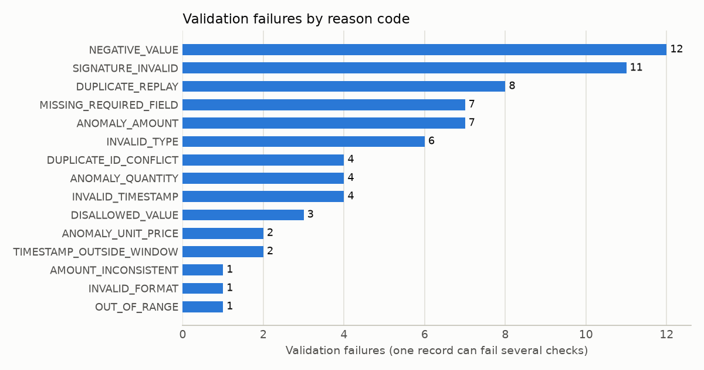
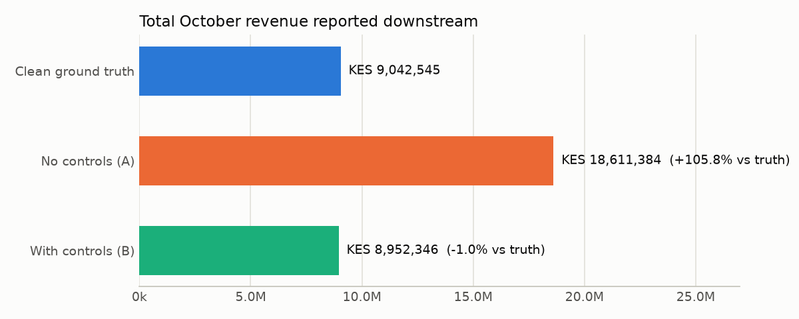
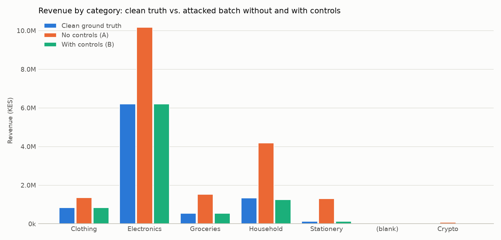
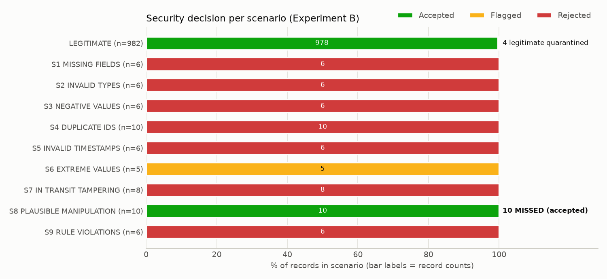

# SecureDataFlow: A Secure Data Ingestion and Validation System

**Course:** DSA 4030 – Big Data Security
**Group:** Group 1 – Securing Data Ingestion Pipelines
**Team members:** *[insert names and student IDs]*
**Date:** 10 November 2026
**Evidence run:** `20261110T111004Z-6cbea4` (`reports/run_output.txt`, `reports/experiment_results.json`)

---

## Executive Summary

We built SecureDataFlow, an ingestion pipeline that receives a batch of transaction records, validates every record, and routes it to a *trusted* zone or a *quarantine* zone with documented reasons. To test it, we generated a fictional batch of 1,000 legitimate transactions and injected **63 manipulated records** across nine attack scenarios. We then measured the effect on a simple downstream business result: October revenue.

| | Clean ground truth | **A: no controls** | **B: with controls** |
|---|---:|---:|---:|
| Records in report | 1,000 | 1,045 | 988 |
| Total revenue (KES) | 9,042,545.44 | **18,611,383.96 (+105.82%)** | **8,952,346.17 (−1.00%)** |
| Largest transaction (KES) | 252,645.88 | 3,420,000.00 | 252,645.88 |

Without controls, the report **more than doubled** true revenue. With controls:

- **53 of the 63** manipulated records were quarantined, which is **100%** of the 53 we designed to be detectable.
- **4 of the 982** legitimate records were wrongly quarantined (0.41%).
- The remaining revenue error fell to **−1.00%**.

The 10 records that got through were a deliberate test of the controls' limits. They are plausible price inflations, signed with a valid source key, which no rule-based validator can distinguish from genuine sales.

All results come from executing `python main.py` and `python -m pytest` (60 tests passed). Nothing in this report is estimated or invented.

---

## 1. Introduction: Securing Data Ingestion Pipelines

Ingestion is the point where data from outside a system's trust boundary enters it. In a big-data lifecycle (ingest → store → process → analyse → act), every later stage inherits whatever ingestion lets through. Storage encryption, access control and careful analytics cannot repair a record that was false when it arrived. Ingestion is therefore both the cheapest and the most important place to stop bad data.

Ingestion faces two related threats:

- **Input tampering:** genuine records are altered in transit or at rest before they are processed, for example a changed amount or a replayed transaction.
- **Data poisoning:** false records are deliberately inserted so that downstream results are distorted. These results include totals, dashboards, fraud models and machine-learning training sets.

Some damage is accidental (malformed exports, unit mistakes). Some is malicious (a compromised partner feed, an insider, an attacker with access to a file drop). A secure ingestion layer has to handle both, without pretending it can always tell them apart.

The objective of this project is to **demonstrate** these risks and **measure** how well practical validation controls reduce them. It focuses on the ingestion component only.

## 2. SecureDataFlow and the Simulated Environment

SecureDataFlow models an organisation that consolidates transactions from five registered, fictional sources into a monthly batch:

| Source ID | Description |
|---|---|
| SRC-001 / SRC-002 | Branch POS systems (North / South) |
| SRC-003 | E-commerce web checkout |
| SRC-004 | Wholesale order portal |
| SRC-005 | Partner marketplace feed |

Nothing in the schema or controls is specific to retail. Any industry that ingests "who sent what, when, how many, at what price" fits the same structure.

### 2.1 Architecture

```text
                    ┌─────────────────────── SecureDataFlow (Experiment B) ───────────────────────┐
 incoming CSV ──►   │ 1 Ingestion         2 Validation & security layer        3 Routing          │
 (attacked batch)   │  run id, UTC time    Pydantic rules (fields, types,       ACCEPTED ─► trusted/│
                    │  source, SHA-256     ranges, allowed values, timestamp,   REJECTED ┐          │
                    │  archive copy +      amount consistency)                  FLAGGED  ┴► quarantine/
                    │  re-hash, raw text   HMAC signature · duplicates ·        (all reasons kept)  │
                    │                      anomaly vs historical baseline                           │
                    │                                    │                                          │
                    │  4 Security logging ◄──────────────┘     5 Downstream report (Flowfile)       │
                    │  security_events.jsonl, ingestion_runs.jsonl, pipeline.log  on trusted/ only  │
                    └───────────────────────────────────────────────────────────────────────────────┘
 Experiment A (no controls): incoming CSV ──► pandas.read_csv ──► same downstream report
```

### 2.2 Implementation map

| Component | File | Responsibility |
|---|---|---|
| Configuration | `config/settings.py` | All policy in one place: allowed sources, categories and currency; ranges; time window; anomaly threshold; demo keys |
| Data generator | `simulation/dataset.py` | Synthetic clean batch and historical reference data |
| Attack simulator | `simulation/attacks.py` | Copies the clean batch, injects attacks, writes the ground-truth manifest |
| Ingestion | `ingestion/loader.py` | `secure_ingest` (metadata, SHA-256, archive, raw text) and `naive_ingest` (Experiment A) |
| Rules | `security/schema.py` | Pydantic model of a valid record |
| Integrity | `security/integrity.py` | HMAC-SHA256 record signatures, SHA-256 file fingerprint |
| Baseline | `security/baseline.py` | Robust per-category statistics from historical data |
| Validator | `security/validator.py` | Runs all checks and assigns ACCEPTED / REJECTED / FLAGGED |
| Routing | `processing/routing.py` | Writes `trusted/` and `quarantine/` (CSV and JSONL with reasons) |
| Downstream report | `processing/summary.py` | Revenue report in Flowfile, with a pandas cross-check |
| Monitoring | `monitoring/` | Security logs, evaluation against ground truth, charts |
| Orchestration | `main.py` | Runs Stage 0 and Experiments A, B and C |

### 2.3 Role of Flowfile

Flowfile 0.24.0 (installed in `.venv`, source kept unmodified in `Flowfile-main/`) is used for the **downstream processing step**. The revenue report is built with Flowfile's `flowfile_frame` API as a graph of Read → Group By → Sort nodes, plus a Polars-code node for overall totals.

Each run saves the graph to `reports/flowfile/*.yaml`. We verified the following:

- On every run, the Flowfile results are compared with an independent pandas calculation. Result: `Flowfile results identical to independent pandas calculation: True`.
- The saved `experimentB_with_controls.yaml` was imported into a running Flowfile server through its `/import_flow/` API and executed. All 4 of 4 nodes succeeded.

We did **not** build the security controls as Flowfile nodes. Flowfile has no built-in schema-contract, signature, quarantine or anomaly nodes (see the initial technical report). Implementing the controls in Python with Pydantic and pandas made them explicit, testable and independent of Flowfile's runtime. Flowfile's Python Script node needs Docker, which is not running on this machine, and Docker is not required for anything in this project.

## 3. Tools and Synthetic Dataset

### 3.1 Tools

| Tool | Version | Use |
|---|---|---|
| Python | 3.12.0 | Implementation language (`.venv`) |
| Flowfile | 0.24.0 | Downstream report pipeline and visual flows |
| Pydantic | 2.14.3 | Declarative per-record validation |
| pandas / NumPy | 3.1.1 / 2.5.4 | Ingestion, batch checks, data generation |
| `hmac`, `hashlib` (stdlib) | – | HMAC-SHA256 signatures, SHA-256 fingerprints |
| matplotlib | 3.11.2 | Result charts |
| pytest | 9.2.0 | Automated tests |
| python-pptx | 1.0.2 | Presentation |

### 3.2 Record schema

| Field | Rule (hard: violation = REJECT) |
|---|---|
| `record_id` | Required. Pattern `TXN-YYYY-NNNNNN`. Unique within the batch. |
| `source_id` | Required. One of the 5 registered sources. |
| `timestamp` | Required. ISO 8601 UTC `YYYY-MM-DDTHH:MM:SSZ`. A real calendar date. Inside the batch window 1–31 Oct 2026. |
| `category` | Required. Electronics, Groceries, Clothing, Household or Stationery. |
| `quantity` | Required. Integer, 1–1,000. |
| `unit_price` | Required. Finite number, KES 1.00–1,000,000.00. |
| `amount` | Required. Finite number > 0, and equal to `quantity × unit_price` within ±0.01. |
| `currency` | Required. `KES`. |
| `signature` | Required. 64 hex characters. A valid HMAC-SHA256 of the other 8 fields under the source's key. |

### 3.3 Datasets

All values are generated from fixed random seeds, so every run reproduces identical data.

| Dataset | File | Records | Purpose |
|---|---|---:|---|
| Clean October batch | `data/raw/transactions_clean.csv` | 1,000 | What the sources legitimately sent. Never modified. |
| Historical Jul–Sep | `data/reference/historical_transactions.csv` | 5,000 | Builds the anomaly baseline |
| Attacked batch | `data/attacked/transactions_incoming_attacked.csv` | 1,045 | The input to both experiments |
| Attack manifest | `data/attacked/attack_manifest.csv` | 1,045 rows | Ground-truth label per row. Used only for evaluation. |

Prices are log-normal per category and quantities are Poisson-distributed. This gives the right-skewed shape of real sales data. The baseline profile computed from the historical data is shown below.

| Category | Hist. records | Median unit price (KES) | Median amount (KES) | Quantity p99.5 |
|---|---:|---:|---:|---:|
| Clothing | 1,001 | 1,862.31 | 3,445.44 | 5.0 |
| Electronics | 670 | 22,407.04 | 26,170.65 | 3.0 |
| Groceries | 1,764 | 346.70 | 1,266.01 | 9.0 |
| Household | 1,041 | 2,413.59 | 4,140.74 | 5.8 |
| Stationery | 524 | 203.10 | 909.17 | 10.4 |

The baseline is built from **historical** data, not from the incoming batch. This is a security decision: if the batch were used to judge itself, poisoned records would shift the very statistics used to detect them.

## 4. Threat Model and Controlled Attack Scenarios

### 4.1 Assets, attackers and assumptions

- **Asset:** the integrity of the ingested batch and of every result computed from it.
- **Attacker 1, in-transit tamperer:** can edit, inject or replay rows between the source and the pipeline, for example through a shared drop folder or an unprotected transfer. This attacker does **not** hold any source signing key.
- **Attacker 2, compromised source or insider:** controls a registered source (modelled as SRC-005, the partner feed). This attacker can therefore produce records with **valid signatures**.
- **Out of scope:** compromise of the pipeline host itself, theft of all keys, denial of service, and confidentiality attacks.

### 4.2 Data classes

We separate three classes of data and do not claim that every quarantined record is malicious:

| Class | Meaning | Pipeline response |
|---|---|---|
| **Invalid** | Breaks a definite rule: missing, wrong type, impossible value, duplicate ID, bad signature | REJECT |
| **Suspicious** | Valid in form but statistically far from history | FLAG for human review (it could be a genuine bulk order) |
| **Plausible but manipulated** | Valid in form and statistically normal, yet false | Can only be caught by integrity controls, if at all |

### 4.3 Scenarios injected (`simulation/attacks.py`)

| ID | Scenario | Rows | Attacker | Examples | Class |
|---|---|---:|---|---|---|
| S1 | Missing required fields | 6 | compromised source | blank source_id, timestamp, category, quantity, amount; signature stripped | invalid |
| S2 | Invalid data types | 6 | compromised source | `three`, `2.5`, `5 units`, `N/A`, `12,5OO.00` (letter O), `NaN` | invalid |
| S3 | Negative values | 6 | compromised source | −2 × 45,000 "reversal"; negative unit price | invalid |
| S4 | Duplicate identifiers | 10 | in-transit replay (8) and compromised source (2) | 8 exact replays of high-value genuine records; 2 new records reusing genuine IDs | invalid |
| S5 | Invalid timestamps | 6 | compromised source | `2026-13-45T10:00:00Z`, `31/10/2026 14:00`, `yesterday`, missing `T`/`Z`, March 2027, Dec 2025 | invalid |
| S6 | Extreme values | 5 | compromised source | 12 × 285,000 Electronics; 400 grocery units at 2,450; all inside hard limits | suspicious |
| S7 | In-transit tampering | 8 | in-transit (no key) | genuine records edited after signing: quantity +2 or price +40%, arithmetic kept consistent | plausible but manipulated |
| S8 | Plausible manipulation | 10 | compromised source | genuine low-priced records inflated 60%, still typical, **re-signed** | plausible but manipulated |
| S9 | Rule violations | 6 | mixed | source SRC-999, category `Crypto`, currency USD, ID `TXN-26-77`, amount ≠ qty × price, quantity 5,000 | invalid |
| | **Total manipulated** | **63** | | 45 injected rows + 18 genuine rows modified in place | |
| | Untouched legitimate | 982 | | | |

S7 and S8 modify genuine records in place. The other scenarios inject new rows at random positions. Replays are always placed after their original, as a real replay would arrive. S8 is the required "plausible but manipulated" case: it is designed to pass every validation rule.

## 5. Demonstration of the Security Failure (Experiment A)

Experiment A ingests the attacked batch the way many quick pipelines do. It calls `pandas.read_csv`, converts numeric columns with `errors="coerce"` (anything unparseable silently becomes NaN), applies no other checks, and runs the revenue report. The report itself is the same Flowfile flow used in Experiment B.

**What went wrong (measured):**

- All **1,045** rows were loaded, including 45 that do not belong in October revenue at all.
- **3 amounts silently became NaN** (`12,5OO.00`, `NaN` and a blank). Their rows still counted as transactions, but their value vanished without any warning.
- Two non-existent categories, **`Crypto` (KES 75,000)** and a **blank category (KES 4,800)**, appeared in the report.
- Rows dated March 2027 and December 2025 were counted as October revenue.
- Total revenue was reported as **KES 18,611,383.96 against a true KES 9,042,545.44 (+105.82%)**. The largest "transaction" was KES 3,420,000, 13.5 times the true maximum.

Because the simulation knows exactly which rows are manipulated, the error can be attributed to each scenario. The contributions sum exactly to the observed error, KES 9,568,838.52. A test checks this reconciliation.

| Scenario | Rows counted | Effect on total revenue (KES) |
|---|---:|---:|
| S6 Extreme values | 5 | **+8,225,000.00** |
| S4 Duplicate IDs (8 replays + 2 collisions) | 10 | +785,747.77 |
| S9 Rule violations | 6 | +736,460.00 |
| S5 Invalid timestamps | 6 | +49,500.00 |
| S1 Missing fields | 6 | +24,000.00 |
| S8 Plausible manipulation | 10 | +13,785.41 |
| S2 Invalid types | 6 | +13,750.00 |
| S7 In-transit tampering | 8 | +12,995.34 |
| S3 Negative values | 6 | **−292,400.00** |
| **Net error** | | **+9,568,838.52** |

The attacks also pull in opposite directions. Negative "reversals" (S3) hide KES 292,400 of inflation elsewhere, so a single plausibility check on the total would be misleading: a mix of attacks can partly cancel out and make a corrupted total look closer to normal than it is.

## 6. Implementation of the Validation and Security Controls (Experiment B)

### 6.1 Ingestion controls (`ingestion/loader.py`)

- **Run metadata:** each run gets a run id, a UTC ingestion time, a source file path and a source label. In the evidence run these were run `20261110T111004Z-6cbea4`, 1,045 records received at 2026-11-10T11:10:04Z.
- **Evidence preservation:** the received file is SHA-256 hashed (`5df2e73d…b0d7185`) and copied to `data/archive/`. The copy is re-hashed and compared (`hash re-verified: True`).
- **Raw-text reading:** every value is read as the exact text received, so `12,5OO.00` is seen and rejected rather than silently converted. The column set is also checked: no missing or unexpected columns.

### 6.2 Record-level rules (Pydantic, `security/schema.py`)

A `TransactionRecord` model implements the rules in §3.2. Its main properties:

- Values must be finite (`allow_inf_nan=False`, so `NaN` and `inf` are rejected).
- `extra="forbid"` blocks unexpected fields.
- Custom validators check source registration, strict timestamp format, real calendar dates and the batch window.
- A model-level validator checks that `amount = quantity × unit_price`.

Pydantic's error types are mapped to stable reason codes, for example `MISSING_REQUIRED_FIELD`, `INVALID_TYPE`, `NEGATIVE_VALUE`, `OUT_OF_RANGE`, `DISALLOWED_VALUE`, `INVALID_FORMAT`, `INVALID_TIMESTAMP`, `TIMESTAMP_OUTSIDE_WINDOW` and `AMOUNT_INCONSISTENT`. Every failure on a record is recorded, not just the first.

### 6.3 Integrity controls (`security/integrity.py`)

**HMAC-SHA256 per record.** Each source signs the canonical string `record_id|source_id|timestamp|category|quantity|unit_price|amount|currency` with its own key. The pipeline recomputes the signature and compares it in constant time (`hmac.compare_digest`).

- **What it detects:** any change to a signed field made by someone without the source's key. This covers the S7 edits, which are otherwise perfectly plausible, records claiming a different source, and unsigned or forged injections.
- **What it does not detect:**
  - a compromised source or stolen key (S8),
  - data that was wrong before signing,
  - replays (a replayed record is a genuine, validly signed record; this is why the duplicate check exists),
  - deleted records (that would need a signed batch manifest with the record count and IDs).

**SHA-256 file fingerprint.** This shows whether the *archived copy* has changed since ingestion. It does **not** prove who created the file or that it was unaltered before we received it: anyone who changes a file can compute a new hash. A hash establishes authenticity only when it is compared with a trusted reference, such as a hash the source published over a separate channel, or when it is signed.

The keys used are demo keys derived from a master secret in `config/settings.py`. In production, each source would keep its own key in a key vault or HSM.

### 6.4 Batch-level duplicate detection (`security/validator.py`)

Records are grouped by `record_id`:

- **Exact copies:** the first copy is kept and the others are rejected as `DUPLICATE_REPLAY`.
- **Same ID, different content:** **all** versions are rejected as `DUPLICATE_ID_CONFLICT`, because the pipeline cannot know which version is genuine. This is a deliberate trade-off. An attacker can use it to get a genuine record quarantined (see §8).

### 6.5 Abnormal-value detection (`security/baseline.py`, `validator.py`)

This check runs only on records that passed every hard rule. Each record is compared with its category's historical baseline using the modified z-score, *z* = 0.6745 · (*x* − median) / MAD, on log(unit_price) and on log(amount). It is flagged if |*z*| > 3.5, the commonly used cut-off. Quantities above twice the historical 99.5th percentile are also flagged.

Medians and MAD are used because, unlike the mean and standard deviation, a few extreme points barely move them. Flagged records are **not** rejected. They are quarantined as `FLAGGED` for review, because a large order may be genuine.

### 6.6 Routing and logging

| Output | Content |
|---|---|
| `data/trusted/trusted_transactions.csv` | ACCEPTED records only, typed, with `run_id`, `ingested_at` and `source_row` lineage |
| `data/quarantine/quarantined_records.csv` / `.jsonl` | Every REJECTED or FLAGGED record with its **original text**, status, reason codes, controls and full explanations |
| `logs/security_events.jsonl` | One event per failed check (run, time, row, record, source, decision, code, control, message). 1,045 rows produced 73 events. |
| `logs/ingestion_runs.jsonl` | One summary per run: metadata, hash, counts, failures by code |
| `logs/pipeline.log` | Human-readable run log, for example `received=1045 accepted=988 rejected=50 flagged=7` |

Sample quarantine entries, copied from the evidence run:

| Row | Record | Status | Reason |
|---:|---|---|---|
| 26 | TXN-2026-001022 | REJECTED | [INVALID_TIMESTAMP] '2026-10-15 14:22:05' is not ISO 8601 UTC |
| 52 | TXN-2026-000049 | REJECTED | [SIGNATURE_INVALID] signature does not match record content |
| 63 | TXN-2026-001026 | FLAGGED | [ANOMALY_AMOUNT] amount 2,775,000.00 has robust z=+8.11 vs Household history; [ANOMALY_QUANTITY] 150 > 2 × p99.5 (5.8) |
| 74 | TXN-2026-000017 | REJECTED | [DUPLICATE_REPLAY] exact repeat of row 17 |
| 183 | TXN-2026-001009 | REJECTED | [INVALID_TYPE] quantity='5 units' |
| 262 | TXN-2026-001018 | REJECTED | [NEGATIVE_VALUE] quantity='-10' |
| 436 | TXN-2026-000419 | REJECTED | [DUPLICATE_ID_CONFLICT] appears in rows [436, 723] with different content |
| 997 | TXN-2026-001034 | REJECTED | [AMOUNT_INCONSISTENT] amount 30,000.00 ≠ quantity × unit_price 3,000.00 |

## 7. Experimental Results and Before-and-After Comparison (Experiment C)

### 7.1 Security decisions

| Decision | Records |
|---|---:|
| Received | 1,045 |
| Accepted → `trusted/` | 988 |
| Rejected (invalid) → `quarantine/` | 50 |
| Flagged (suspicious) → `quarantine/` | 7 |



There were 73 validation failures across 57 quarantined records, because one record can fail several checks. For example, a negative quantity also produces a negative amount. Counted by records, the controls were triggered as follows: duplicates 12, integrity 11, ranges/allowed values 11, anomaly detection 7, timestamps 6, data types 6, required fields 6, consistency 1.

### 7.2 Downstream summary before and after controls

| Metric | Clean truth | A: no controls | A vs truth | B: with controls | B vs truth |
|---|---:|---:|---:|---:|---:|
| Records in report | 1,000 | 1,045 | +4.50% | 988 | −1.20% |
| Total revenue (KES) | 9,042,545.44 | 18,611,383.96 | **+105.82%** | 8,952,346.17 | **−1.00%** |
| Mean transaction (KES) | 9,042.55 | 17,861.21 | +97.52% | 9,061.08 | +0.20% |
| Median transaction (KES) | 2,634.97 | 2,827.32 | +7.30% | 2,644.02 | +0.34% |
| Largest transaction (KES) | 252,645.88 | 3,420,000.00 | +1,253.67% | 252,645.88 | 0.00% |
| Unparseable amounts | 0 | 3 | – | 0 | – |



| Category revenue (KES) | Clean truth | A: no controls | A vs truth | B: with controls | B vs truth |
|---|---:|---:|---:|---:|---:|
| Clothing | 835,014.13 | 1,351,539.91 | +61.86% | 830,859.89 | −0.50% |
| Electronics | 6,200,467.29 | 10,172,379.03 | +64.06% | 6,207,631.26 | +0.12% |
| Groceries | 545,767.71 | 1,526,475.59 | +179.69% | 537,126.00 | −1.58% |
| Household | 1,335,710.56 | 4,185,208.22 | +213.33% | 1,250,747.81 | −6.36% |
| Stationery | 125,585.75 | 1,295,981.21 | +931.95% | 125,981.21 | +0.31% |
| (blank) | – | 4,800.00 | – | – | – |
| Crypto | – | 75,000.00 | – | – | – |



The median moved only 7.3% under attack while the mean almost doubled. This shows why robust statistics resist poisoning, and why a dashboard showing only medians could hide an attack that a total exposes.

### 7.3 Where the remaining −1.00% comes from

| Cause | Rows in trusted output | Effect (KES) |
|---|---:|---:|
| 4 legitimate records quarantined: 2 statistical false positives (KES 70,649.23) and 2 victims of S4 ID collisions (KES 6,556.91) | 978 of 982 | −77,206.14 |
| 8 S7 records rejected, so their genuine pre-tamper value is missing | 0 of 8 | −26,778.54 |
| 10 S8 manipulated records accepted (undetected inflation) | 10 of 10 | +13,785.41 |
| **Net residual** | | **−90,199.27** |

The controls do not make the report equal the truth. They turn a +105.82% error caused by bad data into a −1.00% error caused mostly by **withholding** records for review. Records withheld for review can be recovered, while silently corrupted totals cannot.

## 8. Evaluation of Control Effectiveness

Each decision was scored against the attack manifest. Only a simulation can do this, because in production nobody provides a list of the malicious rows.

| Scenario | Class | Rows | Accepted | Rejected | Flagged | Quarantined | Control(s) that fired |
|---|---|---:|---:|---:|---:|---:|---|
| Legitimate | legitimate | 982 | 978 | 2 | 2 | 0.4% | duplicates (2), anomaly (2) |
| S1 Missing fields | invalid | 6 | 0 | 6 | 0 | 100% | required fields (6), integrity (2) |
| S2 Invalid types | invalid | 6 | 0 | 6 | 0 | 100% | data types (6) |
| S3 Negative values | invalid | 6 | 0 | 6 | 0 | 100% | ranges/allowed values (6) |
| S4 Duplicate IDs | invalid | 10 | 0 | 10 | 0 | 100% | duplicates (10) |
| S5 Invalid timestamps | invalid | 6 | 0 | 6 | 0 | 100% | timestamps (6) |
| S6 Extreme values | suspicious | 5 | 0 | 0 | 5 | 100% | anomaly detection (5) |
| S7 In-transit tampering | plausible, manipulated | 8 | 0 | 8 | 0 | 100% | **integrity only** (8) |
| S8 Plausible manipulation | plausible, manipulated | 10 | **10** | 0 | 0 | **0%** | none |
| S9 Rule violations | invalid | 6 | 0 | 6 | 0 | 100% | ranges/allowed (5), integrity (1), consistency (1) |



**Headline measures:**

| Measure | Value |
|---|---:|
| Legitimate records | 982 |
| Manipulated records | 63 |
| Manipulated records quarantined | 53 (84.1%) |
| Manipulated records quarantined, excluding deliberately undetectable S8 | 53 / 53 (100%) |
| Manipulated records missed | 10 (all S8) |
| Legitimate records quarantined (false-positive rate) | 4 (0.41%) |
| Hard-rule rejections of genuine data when the *clean* batch alone is validated | 0 (verified by test) |

**Observations:**

1. **Layering matters.** No single control caught everything. S7 records passed every content rule, and only the signature caught them. S6 passed every hard rule, and only the statistical baseline caught it. Replays (S4) carried valid signatures, and only the duplicate check caught them.
2. **Most attacks were cheap to stop.** 40 of the 63 manipulated rows (S1–S5 and S9) broke a simple declarative rule or the duplicate-ID rule.
3. **The biggest damage came from values that look valid.** The five S6 records caused 86% of the net revenue error (KES 8.2 M of 9.57 M). They were within every hard limit and were stopped only by comparison with history.
4. **Errors are visible and explained.** Every quarantined record has machine-readable codes and a human-readable explanation, and nothing was dropped silently.

### 8.1 Automated tests

`python -m pytest -v` produced **60 passed in 22.60 s** (full output in `reports/test_results.txt`).

| Requirement | Tests (examples) |
|---|---|
| Valid records accepted | `test_valid_record_is_accepted`, `test_window_boundaries_are_accepted`, `test_clean_batch_alone_is_mostly_accepted` |
| Missing fields rejected | `test_missing_required_field_is_rejected` (8 fields), `test_missing_signature_is_rejected` |
| Invalid values rejected | `test_invalid_type_is_rejected` (7 cases), `test_negative_values_are_rejected`, `test_disallowed_values_are_rejected`, `test_inconsistent_amount_is_rejected` |
| Duplicates detected | `test_exact_replay_rejects_only_the_copy`, `test_id_conflict_rejects_all_versions` |
| Invalid timestamps detected | `test_invalid_timestamp_is_rejected` (5), `test_timestamp_outside_window_is_rejected` (3) |
| Suspicious values flagged | `test_extreme_value_is_flagged_not_rejected`, `test_extreme_unit_price_is_flagged` |
| Integrity | `test_tampering_after_signing_is_detected`, `test_wrong_source_key_is_detected`, `test_replayed_record_still_has_valid_signature` |
| Quarantine separated from trusted | `test_quarantine_is_separated_from_trusted` |
| Downstream comparison | `test_impact_attribution_reconciles_with_totals`, `test_controls_reduce_downstream_error`, `test_flowfile_summary_matches_pandas` |
| Known limitation documented | `test_plausible_manipulation_is_not_detected` |

The first test run found two real defects. Routing crashed when an output folder was outside the project, which was fixed in `processing/routing.py`. One test also used a strict numeric conversion, which was corrected. Both were fixed, and the suite was re-run until it passed.

## 9. Limitations of the Validation Rules

**What the controls cannot detect:**

1. **Plausible manipulation by a trusted source (S8).** A 60% price inflation that stays within the normal range, signed with a valid key, passes every check. In this experiment it added KES 13,785.41 that was accepted as genuine. Catching it would need evidence from outside the record, such as reconciliation against payments, stock levels or the customer's own records.
2. **Low-and-slow poisoning.** Many small shifts, each inside the threshold, can move totals without any record looking abnormal.
3. **Missing records.** Deleting genuine records is undetectable without a signed batch manifest (record count and ID list) from each source.
4. **Collusion between fields.** The consistency rule checks `amount = quantity × unit_price`. An attacker who changes the quantity and amount together (as in S7) passes it, and only the signature stopped S7.

**Risks the controls introduce:**

5. **False positives.** Two genuine records were flagged: a KES 70,569.96 Household sale (z = +3.54) and a KES 79.27 grocery sale (z = −4.01). The 3.5 threshold is a trade-off. Lowering it catches more manipulation but flags more genuine business.
6. **Weaponised conflicts.** Under the ID-conflict policy, an attacker who reuses a genuine ID can get the genuine record quarantined (2 cases, KES 6,556.91). This is a small denial-of-integrity attack. The alternative policy, first-wins, would let a forged record displace a genuine one whenever the forgery arrives first.
7. **First-wins replay handling.** For exact duplicates the first copy is kept. If the content is identical this makes no difference to the totals, but a replay arriving *before* its original would be indistinguishable from it.

**Dependencies and assumptions:**

8. **Baseline quality.** Anomaly detection assumes the historical data is clean and representative. Poisoned history, seasonality or a new product line would cause misses or false alarms. Because the baseline is static, it also needs periodic, controlled refresh.
9. **Key management.** The HMAC keys are demo keys derived from a master secret held in the code. Real security depends on per-source keys stored in a vault, rotated, and revoked when a source is compromised. A plain SHA-256 hash provides no authenticity at all.
10. **Policy correctness.** Hard limits, the batch window and the allowed lists are business decisions. A rule that is too loose admits bad data, and one that is too tight rejects good data. These rules are configuration, not proof.
11. **Logs are not tamper-evident.** The logs are append-only files with no hash chaining or remote shipping, so an administrator could edit them.
12. **Simulation validity.** The attacks were designed by us, so the 100% detection on S1–S7 and S9 shows that each control works as built. It does not predict how well it would catch unknown real-world attacks. Results come from one deterministic 1,045-row batch on one laptop. No performance testing at big-data scale was done.

## 10. Lessons Learned and Recommendations

### Lessons learned

- **Never coerce silently.** The naive pipeline's most dangerous behaviour was not crashing. It turned `12,5OO.00` into nothing and carried on. Reading raw text and rejecting with a reason is safer than "best-effort" parsing.
- **Validity is not truth.** Schema validation stops malformed data, but most of the financial damage came from records that were well formed. Statistical and integrity controls are needed on top.
- **Integrity controls answer "was this changed?", not "is this true?".** HMAC caught every in-transit edit and none of the compromised-source edits. Knowing which question each control answers is what makes the design honest.
- **Quarantine beats deletion.** Keeping rejected records with reasons turns security decisions into an auditable, reversible workflow, and it made the false positives in this report visible.
- **Judge new data against a trusted reference.** Using a separate historical baseline, and not the batch itself, stops the attacker from shifting the yardstick.

### Recommendations

| Priority | Recommendation | Addresses |
|---|---|---|
| 1 | Per-source keys in a key vault, with rotation and revocation; asymmetric signatures (e.g. Ed25519) so the pipeline only needs public keys | Limitation 9 |
| 2 | Signed batch manifests (record count, ID list, batch hash) from each source | Limitations 3 and 7 |
| 3 | A human review workflow for `FLAGGED` records, with release back to `trusted/` and the reviewer's decision logged | Limitations 5 and 6 |
| 4 | Reconciliation against an independent system (payments, inventory), with per-source trend monitoring | Limitations 1 and 2 |
| 5 | Hash-chained or remotely shipped security logs | Limitation 11 |
| 6 | Seasonal, regularly refreshed baselines built only from reviewed data | Limitation 8 |
| 7 | Move the controls into the Flowfile pipeline as custom nodes once its multi-user (Docker) mode is in use, so validation is visible in the visual flow | Integration |

---

## Appendix A: How to Reproduce

```powershell
cd C:\Users\Admin\Downloads\SecureDataFlow
.\.venv\Scripts\Activate.ps1
python main.py          # ≈10–20 s; console copy in reports/run_output.txt
python -m pytest -v     # 60 tests
```

All seeds are fixed (`config/settings.py`), so a re-run reproduces every number in this report. Only the run id, timestamps and archive file name change.

## Appendix B: Evidence Files

| File | Content |
|---|---|
| `reports/run_output.txt` | Full console output of the evidence run |
| `reports/experiment_results.json` | All measured values (machine-readable) |
| `reports/test_results.txt` | Verbose pytest output (60 passed) |
| `reports/figures/fig1–fig4*.png` | Charts generated from the results |
| `reports/flowfile/*.yaml` | Flowfile graphs of the three downstream reports |
| `data/trusted/`, `data/quarantine/` | Routed records with reasons |
| `data/archive/` | Archived input with run id (SHA-256 recorded in logs) |
| `logs/` | Security events, run summaries, pipeline log |
| `data/attacked/attack_manifest.csv` | Ground truth for every row |
